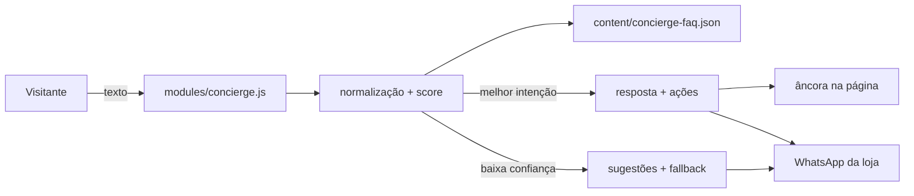

# IA Aplicada — Concierge Local (Hécate)

**Status:** entregue em 2026-11-07. Sem LLM, sem API externa, sem coleta de PII.
**Arquivos:** `content/concierge-faq.json`, `modules/concierge.js`, este documento.
**Integração:** snippet no fim deste arquivo; `index.html` não foi editado.

## 1. Decisão de arquitetura

O concierge é um **retrieval determinístico**: a pergunta do visitante é normalizada, comparada com 19 intenções do FAQ por palavras-chave e sobreposição de termos, e a melhor correspondência retorna uma resposta curta + ações (âncora na página ou WhatsApp). Não há geração de texto em tempo de execução, então a resposta é sempre a mesma para a mesma pergunta e não há risco de alucinação.

Por que não LLM agora:

- O site é estático (vanilla JS + Vercel). Chamar um modelo exigiria chave no cliente (inaceitável), proxy/Cloud Function (fora do escopo) ou Firebase AI Logic com App Check e aprovação de custo/privacidade.
- O volume de dúvidas é pequeno e recorrente; 19 intenções cobrem o balcão.
- CPF, contratos e histórico de compra não podem ir para terceiros sem base legal e aprovação explícita.
- Custo de inferência e latência seriam maiores que o benefício para perguntas de FAQ.



## 2. Componentes e contratos

### 2.1 `content/concierge-faq.json`

Fonte de conteúdo, versionada e editável sem build. Cada intenção tem:

| Campo | Tipo | Função |
|---|---|---|
| `id` | string | identificador estável; usado em `quickReplies` e testes |
| `label` | string | texto do chip e nome curto |
| `questions` | string[] | paráfrases reais; alimentam o score |
| `keywords` | string[] | termos distintivos; podem ser frases |
| `answer` | string | resposta curta (1–3 frases) |
| `actions` | array | `anchor` (`href: "#secao"`), `link` (`href: "pagina.html"`) ou `whatsapp` (`message`, `storeId` opcional) |
| `priority` | number? | desempate quando duas intenções pontuam igual |

O bloco `fallback` define a mensagem e as ações quando nada passa do limite. `quickReplies` lista os chips iniciais.

### 2.2 `modules/concierge.js`

IIFE sem dependências, carregada como script clássico. Cria um host `#miplace-concierge` com **Shadow DOM** (isola CSS e evita conflito com Tailwind/wishlist) e expõe:

```js
window.MiplaceConcierge.version      // "1.0.0"
window.MiplaceConcierge.open()       // abre o painel
window.MiplaceConcierge.close()      // fecha e devolve o foco
window.MiplaceConcierge.toggle()
window.MiplaceConcierge.match(text)  // { intent, score, alternatives } — útil para QA
window.MiplaceConcierge.getData()    // FAQ carregado (ou fallback embutido)
```

O widget carrega o JSON com `fetch('content/concierge-faq.json')` (mesma origem). Se a busca falhar — offline, `file://`, CSP ou JSON inválido — usa um fallback embutido com 6 intenções essenciais. O fallback também cobre o primeiro paint: o painel abre antes do JSON terminar de carregar.

### 2.3 Snippet de integração

Inserir **depois de `stores.js`** (o widget lê `window.STORES` para montar os links de WhatsApp) e antes de `app.js`:

```html
<script src="modules/concierge.js?v=1.0.0" defer></script>
```

Com `defer`, a ordem de execução é a ordem dos scripts; não é necessário alterar `defer` nem o `DOMContentLoaded`. Se o snippet entrar depois de `app.js`, também funciona, desde que `stores.js` já tenha rodado.

## 3. Como o matching funciona

1. **Normalização:** NFD remove acentos, tudo vira minúsculo, pontuação vira espaço. `"Endereço"` e `"endereco"` são iguais.
2. **Tokens:** remove stopwords (`de`, `como`, `quero`, `tem`, `loja`… não; `loja` fica) e tokens com menos de 2 caracteres.
3. **Score por intenção:**
   - sobreposição de tokens com `label + questions`: +1,2 por token único, teto de 5;
   - palavra-chave de um token: +3 (com prefixo para plurais/variações, ex.: `capa` ≈ `capinhas`);
   - palavra-chave frase: +4,5 quando aparece como sequência;
   - pergunta idêntica: +20; pergunta contida na consulta: +6.
4. **Decisão:** melhor score ≥ 4 vence. Se a segunda colocada estiver a menos de 0,5 ponto **e tiver a mesma prioridade**, o resultado é ambíguo e o widget mostra até 3 sugestões em vez de chutar. `priority` no JSON resolve empates editoriais (ex.: preço × marca).
5. **Fallback:** sem score suficiente, mostra a mensagem de fallback + WhatsApp + sugestões acima de 2,5 pontos.

Limites do algoritmo: não faz stemming real nem entende ironia/sinônimos não cadastrados. Cada nova gíria de balcão precisa entrar em `questions` ou `keywords`. Isso é intencional: conteúdo revisável e testável, sem modelo caixa-preta.

### 3.1 Como adicionar uma intenção

1. Copie um bloco em `intents`, escolha um `id` estável.
2. Escreva 3–5 `questions` como o cliente digita (com e sem acento, com gíria).
3. Liste `keywords` distintivas; evite termos genéricos (`loja`, `produto`) sem necessidade.
4. Resposta de 1–3 frases, sem preço/prazo não confirmado; use "confirme na loja".
5. Ações: no máximo 2; WhatsApp com mensagem genérica, sem PII.
6. Rode a avaliação (seção 4) e ajuste `priority` se houver empate.
7. Suba `version` e `updatedAt`.

## 4. Avaliação

### 4.1 Harness de matching

O módulo pode ser carregado em Node sem DOM (a IIFE só inicializa a UI quando `document` existe). O teste lê o JSON, injeta o módulo em `vm` e chama `match`:

```js
const context = { window: {}, console, URLSearchParams, setTimeout, clearTimeout, encodeURIComponent };
vm.createContext(context);
vm.runInContext(fs.readFileSync('modules/concierge.js', 'utf8'), context);
const result = context.window.MiplaceConcierge.match('como funciona o parcelamento', faq);
```

Resultado em 2026-11-07: **38/38** na suíte principal e **51/51** na suíte ampliada (89 casos curados), incluindo 1 caso deliberadamente ambíguo (`"quero trocar de celular"`) que deve cair em sugestões, não em resposta única.

Casos representativos:

| Consulta | Intenção esperada |
|---|---|
| como funciona o parcelamento | parcelamento |
| é sem consulta | parcelamento |
| aceita pix | formas-pagamento |
| tem garantia | garantia |
| meu celular quebrou | pós-venda |
| quero devolver | troca-devolucao |
| onde ficam as lojas | lojas |
| vocês atendem em amparo | lojas |
| vocês vendem iphone | marcas |
| quais produtos tem | produtos |
| quanto custa o iphone | precos |
| tem em estoque | estoque |
| qual celular bom para fotos | escolher-modelo |
| tem capinha | acessorios |
| quais documentos preciso levar | crediario-documentos |
| segunda via do boleto | segunda-via-boleto |
| qual o whatsapp da loja | falar-atendente |
| como envio meu currículo | carreiras |
| quero falar com a imprensa | imprensa |
| quem é a miplace | sobre |
| vocês salvam meu cpf | privacidade |
| bom dia | fallback |
| qual a capital da frança | fallback |
| vocês fazem entrega | fallback |

### 4.2 Teste de navegador (Chromium headless)

Executado em 2026-11-07 com Playwright/Chromium 1243 sobre o site servido localmente:

- 19 intenções carregadas do JSON (não fallback);
- launcher visível, painel oculto no início e aberto no clique; `aria-expanded` alterna `true/false`;
- foco vai para o input ao abrir e volta ao launcher no ESC;
- pergunta "como funciona o parcelamento" retorna resposta com "24x";
- "quero falar com um atendente" renderiza 4 lojas e links `wa.me` corretos (XV Prime → `5519989605504`);
- viewport 360×800: painel 338 px de largura, dentro da tela, acima do launcher;
- zero erros de console/página.

Não testado: leitores de tela reais (NVDA/VoiceOver), Safari/Firefox, clique real no WhatsApp e CSP de produção. Esses itens ficam para Argos/Íris.

## 5. Privacidade e segurança

- **Nenhum dado pessoal é coletado, enviado ou persistido.** A conversa existe só no DOM do painel e desaparece ao fechar/recarregar. Não há `localStorage`, cookie, sessionStorage ou log de pergunta.
- **Nenhuma chamada externa em runtime.** O único `fetch` é o JSON do mesmo domínio. O WhatsApp só abre quando o visitante clica; a mensagem pré-preenchida é genérica e não contém dado do cliente.
- **XSS:** respostas entram por `textContent`; o HTML estático do painel não interpola dados; `safeHref` aceita apenas `#`, `/`, `https://` e `*.html`, bloqueando `javascript:`.
- **Superfície:** Shadow DOM isola estilos; o widget não lê o formulário de contato nem o catálogo. Não há `eval`, `Function` ou script remoto.
- **Orientação ao visitante:** o rodapé do painel diz "Conversa local, sem cadastro. Não envie dados pessoais." Perguntas sobre boleto/crediário orientam explicitamente a não enviar CPF/documentos pelo chat.
- **LGPD:** por não haver transmissão a terceiros, não existe transferência de dados pessoais neste fluxo. O JSON é público e não contém PII. A política de privacidade do site é linkada na intenção `privacidade`.
- **Risco residual:** o visitante pode digitar PII no campo; o texto fica no DOM local e não é enviado. Em computador compartilhado, o risco é o mesmo de qualquer campo de chat — o aviso e a ausência de persistência reduzem o impacto.
- **CSP atual:** `connect-src 'self'` já permite o `fetch` local; não é necessário alterar `vercel.json` para o widget funcionar. Se o site ganhar CSP mais restritiva, o fallback embutido mantém o concierge operando.

## 6. Limites conhecidos

- **Conteúdo:** 19 intenções em PT-BR. EN/ES ainda não têm FAQ; o widget mostra PT mesmo com o site em outro idioma.
- **Sem tempo real:** não consulta estoque, preço, boleto, pedido ou cadastro. Essas perguntas terminam em "confirme na loja" + WhatsApp.
- **Sem LLM:** não responde perguntas fora do FAQ, não resume, não negocia e não interpreta texto longo. A taxa de fallback deve ser monitorada.
- **Sem persistência:** recarregar a página zera a conversa (por design).
- **Dependência de `stores.js`:** se `window.STORES` não estiver disponível, o WhatsApp cai em "Ver contato" (`#contato`).
- **Shadow DOM:** navegadores modernos e leitores de tela atuais atravessam shadow roots; versões antigas podem não anunciar o conteúdo. Validar com Argos/Íris.
- **Conteúdo datado:** "28 produtos", "9 marcas", "4 lojas" e "24x" precisam de revisão quando o catálogo/condições mudarem. O JSON é a fonte; não espalhe esses números em outros lugares.
- **Sem métricas:** não há contador de abertura/resolução. Se o time quiser medir, usar apenas `intent.id` (nunca o texto) e com opt-in.

## 7. Roadmap para LLM/RAG (com aprovação humana)

**Fase 0 — atual (determinística).** Custo de runtime R$ 0; latência < 10 ms no match; conteúdo auditável.

**Fase 1 — retrieval híbrido local.** Embeddings leves no navegador (transformers.js, modelo quantizado ~25–40 MB) para achar paráfrases que o keyword não pega; a resposta continua vindo do FAQ. Sem LLM, sem PII, custo R$ 0. Critério: fallback > 20% ou FAQ > 50 intenções.

**Fase 2 — geração com citação.** LLM apenas para redigir a resposta a partir dos trechos recuperados, com citação obrigatória e "não encontrei" quando a confiança for baixa. Opções: Firebase AI Logic (App Check já previsto no site) ou modelo on-device. **Requer aprovação explícita** de custo, provedor e base legal; enviar somente texto de política, nunca CPF/contrato/histórico.

**Fase 3 — agente com ferramentas somente leitura.** Consultar catálogo/estoque por API interna, montar handoff com resumo e abrir WhatsApp. Sem escrita no banco, sem pagamento, sem promessa de prazo.

**Guardrails para qualquer fase com LLM:**

- decisão final e handoff continuam humanos; o modelo nunca promete preço, prazo ou aprovação;
- redação de PII antes do envio e proibição de contrato integral;
- defesa contra prompt injection (texto do usuário é entrada não confiável; saída em schema);
- avaliação de regressão com o mesmo conjunto de 89 casos + casos novos;
- limite de custo por sessão e botão de desligar o módulo;
- log sem PII (id da intenção, confiança, latência), retenção curta;
- revisão jurídica/LGPD antes de qualquer transmissão externa.

## 8. Operação e handoffs

- **Conteúdo:** Hécate mantém `concierge-faq.json`; revisão mensal ou a cada mudança de preço/prazo/loja. `version` e `updatedAt` sobem juntos.
- **Integração:** Afrodite insere o snippet no `index.html` (fora do escopo desta entrega).
- **PWA/offline:** Daedalus deve incluir `content/concierge-faq.json` no precache do `sw.js`; o fallback embutido cobre a primeira visita offline.
- **Cache:** Hermes/Atlas podem aplicar `Cache-Control: public, max-age=3600, stale-while-revalidate=86400` ao JSON (não é necessário para funcionar).
- **QA:** Argos replica a suíte de 89 casos e o teste de navegador; Íris revisa contraste, foco e leitor de tela.
- **Segurança:** Ártemis valida a CSP de produção e o link de WhatsApp; nenhuma mudança de CSP é necessária hoje.

## 9. Pendências registradas

- [ ] Inserir o snippet no `index.html` (Afrodite).
- [ ] Incluir o JSON no precache do service worker (Daedalus).
- [ ] Teste com NVDA/VoiceOver e Safari/Firefox (Argos/Íris).
- [ ] Decidir se o concierge terá EN/ES ou aviso "atendimento em português" (Afrodite/Hécate).
- [ ] Definir owner e cadência de revisão do FAQ (Hera/Hécate).
- [ ] Se o catálogo mudar de 28 produtos/9 marcas, atualizar a resposta de `produtos`/`marcas` no JSON.
