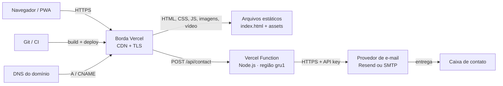

# INFRA — Hospedagem, CDN e Serverless (Vercel)

> **Autor:** Atlas — Engenheiro de Infraestrutura & Cloud
> **Data:** 07/11/2026
> **Escopo:** site estático + função serverless de contato (`/api/contact`), Vercel.
> **Status:** documento de arquitetura e operação. Não houve acesso à conta/projeto Vercel; tudo que depende dela está marcado como **verificar no painel**. O domínio `miplacemagazine.com.br` não resolve hoje (NXDOMAIN), então não foi possível validar o deployment real, TLS ou redirects.

## 1. Arquitetura

- **CDN/edge:** o HTML e os assets são servidos pela borda do provedor; não há servidor de origem próprio. O cache é definido por `Cache-Control` no `vercel.json` e pelas configurações do projeto.
- **Assets estáticos:** `index.html`, `tailwind.css`, `styles.css`, `app.js`, `stores.js`, `modules/*`, `produtos.json`, imagens, vídeos, `sw.js` e `favicon_io/`. O deployment atual tem ~37 MB (sem `node_modules`), incluindo 19,4 MB de imagens, 4,4 MB de vídeo e 6,5 MB de áudio.
- **Serverless:** apenas `POST /api/contact`; a função valida o JSON, aplica honeypot/rate limit e envia e-mail por um provedor. É stateless: não grava lead em banco. O diretório `api/` ainda **não existe** no repositório — a função é entregue por Hefesto.
- **DNS/TLS:** apex e `www` devem apontar para a Vercel; o certificado TLS é emitido e renovado automaticamente pelo provedor após a zona existir. O DNS atual está **NXDOMAIN** para `miplacemagazine.com.br` e `www` (verificado em 07/11/2026 20:03 BRT com `dig`), então o go-live está bloqueado até a zona existir.
- **Sem operação internacional:** a arquitetura usa a rede de entrega do provedor; não há filial, escritório ou operação da Miplace fora do Brasil.

## 2. Ambientes, domínios e redirects

| Ambiente | Origem | URL | Uso | Proteção |
|---|---|---|---|---|
| Produção | branch `main` | `https://miplacemagazine.com.br` (apex) | público | TLS + HSTS |
| Preview | branches/PRs | `https://<projeto>-<hash>-<escopo>.vercel.app` | revisão interna | proteção de deployment conforme o plano; adicionar `X-Robots-Tag: noindex` |
| Desenvolvimento | máquina local | `http://localhost:3000` via `vercel dev` | implementação | sem domínio público |

**Domínio canônico:** apex `miplacemagazine.com.br` (já é o usado em canonical, OG e `stores.js`). `www` deve responder **308 para o apex**, preservando path e query; o inverso criaria conteúdo duplicado e quebraria links existentes.

- **Registros esperados** (confirmar no painel Vercel antes de aplicar): apex `A 76.76.21.21`; `www` `CNAME cname.vercel-dns.com`. Se a Vercel gerenciar o DNS, usar os nameservers dela; se o DNS for externo, manter a zona no registrador e criar só esses registros.
- **E-mail:** antes de trocar nameservers, copiar MX, SPF, DKIM e DMARC. O domínio pode ter e-mail corporativo; perder MX derruba a caixa de contato. Não foi possível verificar MX porque o domínio não resolve.
- **TLS:** certificado automático para apex e `www`; forçar HTTPS; não fixar certificado manual.
- **HSTS:** o `vercel.json` já envia `Strict-Transport-Security: max-age=63072000; includeSubDomains; preload`. `includeSubDomains` exige que **todos** os subdomínios sejam HTTPS; auditar antes. `preload` é definitivo na prática: só submeter à lista depois de 2–4 semanas estável. Se houver dúvida, começar com `max-age=15552000` sem `preload`.
- **Redirects:** configurar no painel de domínios (primário apex, `www` redireciona) ou em `redirects` no `vercel.json`; não confiar só no alias. Testar `http://`, `https://www`, path profundo e query string.

## 3. Cache, CDN e limites

### 3.1 Política recomendada

| Recurso | Cache recomendado | Motivo |
|---|---|---|
| `/`, `/index.html` | `public, max-age=0, must-revalidate` | HTML precisa apontar para a versão nova; ETag evita download repetido |
| `/app.js`, `/stores.js`, `/modules/*.js`, `/tailwind.css`, `/styles.css` | `public, max-age=31536000, immutable` **somente** com hash no nome ou `?v=` incrementado em todo release; caso contrário, `max-age=0, must-revalidate` | os arquivos atuais não têm hash; o `?v=1.2.0` é manual e pode ficar para trás |
| `/produtos.json` | `public, max-age=300, stale-while-revalidate=86400` | catálogo muda; 1 h (config atual) é aceitável, 5 min é mais previsível |
| `/sw.js` | `no-cache` + `Service-Worker-Allowed: /` | o navegador precisa buscar a versão nova do service worker |
| `/favicon_io/*`, imagens, vídeos, fontes | `public, max-age=31536000, immutable` | renomear o arquivo ao trocar; asset sem versão não deve ter 1 ano |
| `/api/*` | `no-store` | resposta personalizada e envio de e-mail |

O `vercel.json` atual aplica `immutable` de 1 ano em `/app.js`, `/stores.js`, `/styles.css`, `/tailwind.css` e `/modules/(ui|catalog|modal|wishlist).js`, todos **sem hash**. O `index.html` usa `?v=1.2.0`; se a versão não for incrementada em cada release, o usuário pode ficar até 1 ano com JS/CSS antigo. Corrigir antes do go-live: hash de build (preferível) ou `must-revalidate` nesses caminhos e bump obrigatório do `?v=` no mesmo commit.

Também validar os padrões `/(.*\\.webp)`, `/(.*\\.mp4)` e `/modules/(ui|catalog|modal|wishlist).js`: a sintaxe de `source` da Vercel é path-to-regexp e o escape/alternância pode não casar como esperado; conferir com `curl -I` em um `.webp` e em `modules/ui.js` depois do deploy.

### 3.2 Limites que importam

- **Transferência:** Pro inclui 1 TB/mês; excedente US$ 0,15/GB. Hobby inclui 100 GB/mês e é **não comercial**.
- **Requisições de CDN:** Pro inclui 10 milhões/mês; excedente a partir de US$ 2/milhão.
- **Function:** corpo de requisição/resposta até 4,5 MB; duração padrão de 10 s (configurar `maxDuration: 10`); 1 milhão de invocações/mês no Hobby e excedente a US$ 0,60/milhão no Pro (confirmar franquia do plano).
- **Deploy:** ~37 MB; não é limite crítico, mas o áudio de 6,5 MB e o vídeo de 4,3 MB dominam o peso. O briefing remove o player de música; manter o MP3 sob demanda, fora do precache e longe do LCP.
- **Build:** `tailwind.css` está no `.gitignore` e é gerado por `npm run build:css`; o projeto Vercel precisa rodar `npm run build` (ou `build:css`) antes de publicar. Sem isso, o CSS pode ir vazio/404.

### 3.3 Regiões

- **Estático:** servido pela borda; não há região fixa.
- **Função:** fixar `gru1` (São Paulo) para o formulário, se disponível no plano; fallback `iad1` adiciona ~100–150 ms. Declarar no `vercel.json` (`"regions": ["gru1"]`) e confirmar no painel.
- **Provedor de e-mail:** pode processar fora do Brasil; se o formulário enviar nome/e-mail/telefone, registrar a transferência na política de privacidade (LGPD) e escolher região/contrato do provedor.

## 4. Disponibilidade e DR

### 4.1 Premissas

- Site estático sem banco: o “dado” é o código, `produtos.json`, `stores.js`, `content/` e a configuração de deployment.
- A função de contato não persiste leads; se passar a persistir, este plano precisa de backup de banco e retenção.
- Não há `.git` no diretório local. Sem repositório remoto, o RPO real é o último upload manual, não um commit — isso precisa ser resolvido antes do go-live.

| Ativo | RPO proposto | RTO proposto | Como recuperar |
|---|---|---|---|
| Código e conteúdo | 0 (todo push) | 15 min | rollback para deployment anterior ou redeploy do commit |
| Configuração (`vercel.json`) | 0 (versionada) | 15 min | git + deploy |
| Segredos | último backup no cofre | 30 min | recriar env vars no painel; rotacionar chaves |
| DNS/TLS | último export da zona | 1–4 h | reaplicar registros; certificado reemite |
| Função | 0 | 15 min | redeploy; função stateless |

- **Backup:** conectar o projeto a um repositório Git privado; manter todo o conteúdo versionado (incluindo `produtos.json`, `stores.js`, `content/`, `vercel.json` e `sw.js`); guardar um inventário **sem valores** das env vars; exportar a zona DNS; manter as últimas releases na Vercel.
- **Rollback:** ensaiar trimestralmente o “Redeploy” de um deployment anterior e o rollback por Git. Medir o tempo real; o alvo é ≤15 min.
- **Indisponibilidade da Vercel:** o site estático pode ter um standby em Cloudflare Pages ou S3 + CloudFront, com o mesmo build. Só vale a pena se o custo de indisponibilidade justificar; exige baixar o TTL do DNS para 300 s antes e manter o standby atualizado. Não é necessário para a primeira versão.
- **SLA:** Hobby/Pro não têm SLA contratual; Enterprise tem. Para um site de catálogo, propor disponibilidade de 99,9%/mês (≈43 min de indisponibilidade) e acompanhar o status do provedor; não prometer SLA ao cliente sem contrato Enterprise.
- **Monitoração:** uptime sintético em `/` e `/api/contact` (sem enviar e-mail real), alerta para o responsável; logs de função com retenção curta no Pro — exportar para Sentry/Log Drain se quiser histórico.

## 5. FinOps — estimativa mensal (marcada como estimativa)

Premissas: 10 mil, 50 mil e 200 mil visitas/mês; 3–8 MB por visita (primeira visita baixa o vídeo de 4,3 MB e imagens; visitas seguintes usam cache e ficam menores); função de contato com 1 mil–10 mil envios/mês. Preços públicos da Vercel consultados em 07/11/2026; **confirmar no checkout**, pois plano, seats e franquias podem mudar.

| Item | 10 mil visitas | 50 mil visitas | 200 mil visitas |
|---|---|---|---|
| Plano Pro (1 seat) | US$ 20 | US$ 20 | US$ 20 |
| Transferência (3–8 MB/visita) | 30–80 GB (incluso) | 150–400 GB (incluso) | 600 GB–1,6 TB (0–600 GB excedente) |
| Excedente de transferência | US$ 0 | US$ 0 | US$ 0–90 |
| Requisições CDN (30–50/visita) | 0,3–0,5 M (incluso) | 1,5–2,5 M (incluso) | 6–10 M (incluso) |
| Função de contato | incluso | incluso | incluso (≪1 M) |
| **Subtotal Vercel** | **US$ 20** | **US$ 20** | **US$ 20–110** |
| Domínio `.com.br` | ~R$ 40/ano (externo) | ~R$ 40/ano | ~R$ 40/ano |
| Provedor de e-mail | conforme plano (externo) | conforme plano | conforme plano |

- **Hobby:** US$ 0, mas é **não comercial** e tem 100 GB/mês. Com 3–5 MB por visita, o limite chega por volta de 20–33 mil visitas; para uma loja, o Pro é o piso legal e operacional.
- **Otimização de maior impacto:** vídeo `hero-1080.mp4` (9,8 MB) e áudio (6,5 MB) são os maiores itens. Manter o áudio sob demanda e servir o vídeo só após interação ou em versão comprimida reduz a transferência e melhora o LCP. Imagens somam 19,4 MB, mas são lazy-load; converter para AVIF/WebP responsivo reduz o pico.
- **Fora do escopo desta estimativa:** provedor de e-mail (Resend/SMTP), monitoração, domínio e eventual standby. Não há conta/contrato Vercel neste repositório; os valores acima são faixas públicas, não fatura.

## 6. Segredos e segregação

- **Onde ficam:** Vercel Project Settings → Environment Variables, com escopos separados `Production`, `Preview` e `Development`. Nunca em `vercel.json`, no HTML, em `modules/*.js` ou em repositório.
- **Variáveis previstas:** `RESEND_API_KEY` (ou credencial SMTP), `CONTACT_TO_EMAIL`, `CONTACT_FROM_EMAIL`; se houver captcha, `TURNSTILE_SECRET`. Todas server-side; nenhuma com prefixo público (`VITE_`, `NEXT_PUBLIC_`).
- **Menor privilégio:** chave do provedor restrita ao domínio de envio; chave separada para preview; rotação trimestral e em desligamento; não reutilizar a chave de produção em preview.
- **Preview:** usar caixa de teste e chave restrita; nunca apontar `CONTACT_TO_EMAIL` de preview para a caixa real; bloquear envio externo se o preview for público.
- **Logs:** não logar corpo completo (nome, e-mail, telefone, mensagem); registrar apenas status, tempo e código de erro. Vercel logs têm retenção curta; se exportar, revisar PII.
- **Do repositório:** `.env`/`.env.local` já estão no `.gitignore`; não há `.env` no diretório. O `vercel.json` não contém segredo. O cofre deve ter o inventário de nomes e responsáveis, não os valores no git.
- **Pendência:** provedor de envio ainda não definido (PENDENCIAS #7). Até definir, `/api/contact` deve responder 503 com fallback WhatsApp — nunca simular envio.

## 7. Checklist de go-live

**DNS e domínio**
- [ ] Zona `miplacemagazine.com.br` existe e resolve (`dig +short A miplacemagazine.com.br`).
- [ ] Apex aponta para a Vercel; `www` tem CNAME e responde 308 para o apex.
- [ ] MX/SPF/DKIM/DMARC copiados antes de qualquer troca de nameserver.
- [ ] Certificado emitido para apex e `www`; HTTP redireciona para HTTPS.
- [ ] HSTS validado; `preload` só após auditoria de subdomínios.

**Vercel e build**
- [ ] Projeto conectado a repositório Git privado (hoje não há `.git`).
- [ ] Build command `npm run build`; output correto; `tailwind.css` gerado.
- [ ] Node/runtime e região da função (`gru1`) definidos.
- [ ] `outputDirectory: "."` revisado: `docs/`, `AGENTS.md`, `scripts/`, `package.json` e `vercel.json` não devem ser públicos; usar `dist/` ou `.vercelignore`.
- [ ] Deployment de preview protegido e com `noindex`.

**Cache e segurança**
- [ ] `curl -I` confirma `no-cache` no HTML e `immutable` só em asset versionado.
- [ ] `sw.js` com `no-cache` e `CACHE_NAME` incrementado neste release.
- [ ] Headers de segurança conferidos (CSP, HSTS, `X-Content-Type-Options`, `Referrer-Policy`, `Permissions-Policy`).
- [ ] Nenhum arquivo interno acessível (`/AGENTS.md`, `/docs/olimpo/BRIEFING.md`, `/package.json` → 404).
- [ ] `vercel.json` sem segredo; env vars só no painel.

**Função de contato**
- [ ] `api/contact.js` existe e responde 405 para métodos diferentes de POST.
- [ ] Validação de schema, honeypot, limite de corpo e rate limit por IP/e-mail.
- [ ] Teste real de envio, erro de provedor, timeout e fallback WhatsApp.
- [ ] SPF/DKIM/DMARC do domínio de envio aprovados; e-mail não cai em spam.
- [ ] Nenhum PII nos logs.

**Operação**
- [ ] Uptime em `/` e `/api/contact`; alerta para responsável.
- [ ] Rollback ensaiado (≤15 min) e release anterior identificável.
- [ ] Backup do código, conteúdo, configuração e inventário de segredos.
- [ ] Política de privacidade cobre dados do formulário e provedor de e-mail.
- [ ] Lighthouse/performance medidos; vídeo/áudio não bloqueiam o first load.

## 8. Evidências do estado atual (repo, somente leitura)

- `vercel.json:1-3` — `outputDirectory: "."`; o output é a raiz do projeto, não um `dist/`.
- `vercel.json:4-38` — cache `immutable` de 1 ano em JS/CSS sem hash (`/app.js`, `/styles.css`, `/tailwind.css`, `/stores.js`, `/modules/...`).
- `vercel.json:48-58` — CSP, HSTS, `X-Frame-Options`, `Referrer-Policy`, `Permissions-Policy`; não há `redirects` nem `regions`.
- `index.html:70-101` — CSS/JS com `?v=1.2.0`; o cache-bust depende de bump manual.
- `sw.js:7-8` — `BUILD_TIMESTAMP = '1.2.2'` e `CACHE_NAME` versionado; `app.js:383-384` registra `/sw.js`.
- `package.json:6-17` — `build` gera `tailwind.css`, que está no `.gitignore`; o deploy precisa rodar o build.
- `ls api` — diretório inexistente; `/api/contact` ainda não implementada.
- `dig` em 07/11/2026 20:03 BRT — `miplacemagazine.com.br` e `www` retornam NXDOMAIN.
- `du -sh` — ~37 MB no diretório publicado (sem `node_modules`), incluindo 4,4 MB de vídeo, 6,5 MB de áudio e 19,4 MB de imagens.
- `git status` — não há repositório Git no diretório; RPO/rollback por commit não existem hoje.

## 9. Decisões que precisam de aprovação

1. **Plano Vercel Pro** (US$ 20/mês por assento) para uso comercial e 1 TB de transferência, com teto de gasto e alerta; o Hobby não atende loja.
2. **Topologia de publicação:** conectar Git privado e publicar um `dist/` mínimo (com `.vercelignore`), em vez de `outputDirectory: "."`; isso evita expor `docs/`, `AGENTS.md` e `scripts/`.
3. **Domínio/DNS:** apex como canônico, `www` 308 para apex, DNS na Vercel ou externo com os registros acima; preservar MX e só submeter HSTS `preload` após auditoria.

## 10. Perguntas em aberto

1. O domínio `miplacemagazine.com.br` está registrado e sob qual conta/registrador? Hoje não resolve.
2. Qual o provedor de e-mail do formulário (Resend/SMTP) e qual caixa recebe os contatos?
3. Existe e-mail corporativo no domínio (MX) e quem aprova a troca de nameservers?
